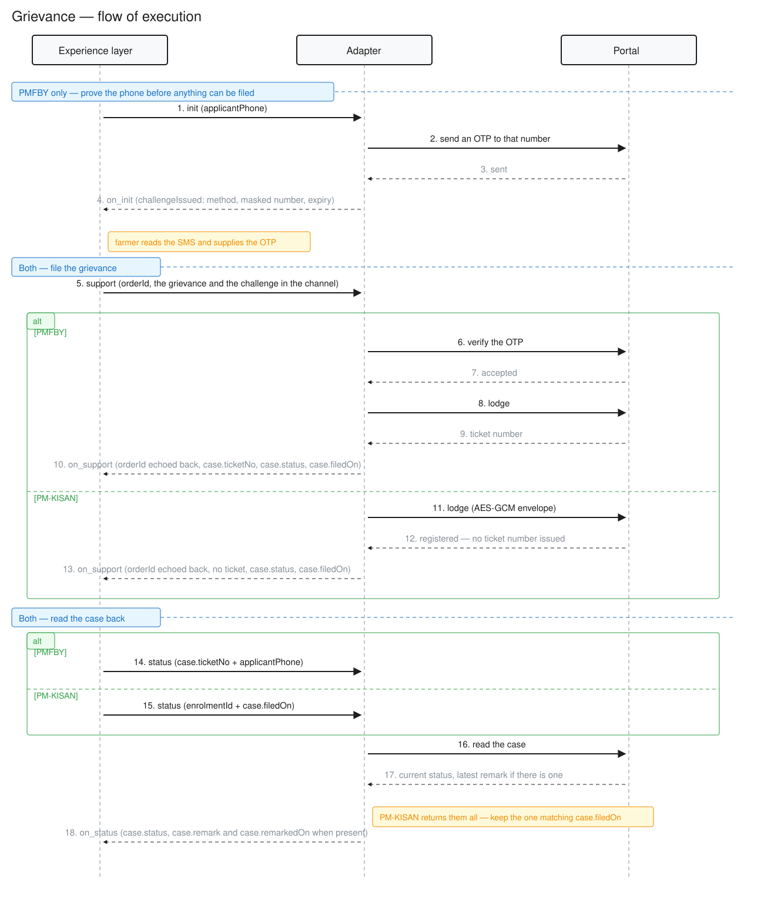

# Grievance and application status — flow of execution

Three capabilities across two schemes, written as the journeys a farmer actually takes.
Each scenario is complete on its own: the calls in order, and the payloads they carry.
The appendices are the reference tables: what each call must carry, the errors,
the catalogs the adapter publishes, and the registry records behind them.

Two schema packs cover the three. **`Grievance`** serves both schemes — one `@type`, with
`scheme.code` naming the desk — and **`SchemeApplication`** serves the application-status
read.

---

## Contents

1. [What this is](#1-what-this-is)
2. [Before any scenario — `discover`](#2-before-any-scenario--discover)
3. [PMFBY grievance](#3-pmfby-grievance) — `support`, then `status`
   - 3.1 [A claim that never arrived](#31-scenario--a-claim-that-never-arrived)
   - 3.2 [The same farmer checks his complaint four days later](#32-scenario--the-same-farmer-checks-his-complaint-four-days-later)
4. [PM-KISAN grievance](#4-pm-kisan-grievance) — `init` → `support`, then `init` → `status`
   - 4.1 [Filing a complaint, with the registration proved first](#41-scenario--filing-a-complaint-with-the-registration-proved-first)
   - 4.2 [Checking it four days later](#42-scenario--checking-it-four-days-later)
5. [PM-KISAN application status](#5-pm-kisan-application-status) — `init` → `status`
   - 5.1 [The instalment has not arrived](#51-scenario--the-instalment-has-not-arrived)

Appendices — the reference material the scenarios point at:

- A. [Required fields by call](#appendix-a--required-fields-by-call)
- B. [Errors](#appendix-b--errors)
- C. [What the adapter publishes](#appendix-c--what-the-adapter-publishes)
- D. [Registry](#appendix-d--registry)

---

## 1. What this is

Three capabilities, five scenarios:

| what | scheme | the farmer wants to | scenarios |
|---|---|---|---|
| File a grievance | PMFBY | complain about a crop-insurance enrolment or claim | §3.1, §3.2 |
| File a grievance | PM-KISAN | complain about an income-support registration | §4.1, §4.2 |
| Check application status | PM-KISAN | find out why an instalment has not arrived | §5.1 |

Three parties take part:

- **Experience layer** — the app or chatbot the farmer uses.
- **Adapter** — this network's piece. It turns Beckn calls into portal calls, and the
  answers back into Beckn.
- **Portal** — the scheme's own system. PMFBY and PM-KISAN each have one.

**"Caller" means whoever sent the request the adapter is answering.** In practice that is
the experience layer, but the packs do not care who it is, so the word is used throughout
for the sending side. "Portal" is used for the answering side in the same way.

Every call is synchronous. You send a request and get the answer on the same HTTP
response. Nothing arrives later on a callback.

Where this document says something is open, it is collected in
[grievance-open-questions.md](grievance-open-questions.md), which is the list to take to
the portals.

One rule shapes everything below: **the catalog says whether a desk asks for an OTP**,
which is why the PM-KISAN scenarios have an extra call at the front. See
[§2](#2-before-any-scenario--discover).

At a glance, the three differ like this:

| | PMFBY grievance | PM-KISAN grievance | PM-KISAN application status |
|---|---|---|---|
| Calls | `support` → `status` | `init` → `support`, then `init` → `status` | `init` → `status` |
| Identity proof | none — PMFBY publishes no challenge | `SMS_OTP`, four digits, on the lodge **and** on the read | `SMS_OTP`, four digits, on the read |
| Farmer is known by | application number on the way in, ticket number on the way back; the phone is an unverified contact | registration number | registration or mobile number — the caller says which |
| What comes back | ticket number, status, crop | ticket number, status, the officer's reply | instalments paid, eKYC, what is blocking payment |
| `@type` | `openagrinet:Grievance` | `openagrinet:Grievance` | `openagrinet:SchemeApplication` |
| Told apart by | `scheme.code: PMFBY` | `scheme.code: PM-KISAN` | its own `@type` |



Both schemes are on that one page. Follow the `[PMFBY]` branches for §3, and the
`[PM-KISAN]` branches for §4 and §5.

---

## 2. Before any scenario — `discover`

`discover` runs once. It asks the network what exists and returns a catalog. It is not
part of any scenario. You do not repeat it per grievance.

```json
POST /discover
{
  "context": {
    "version": "2.0.0", "action": "discover", "networkId": "openagrinet",
    "transactionId": "0f3b7d21-8c45-4e96-b2a7-5d1c8e0f4a93",
    "messageId": "6a9e2c58-1d74-4b03-8f5a-7c2b9e6d0a14",
    "timestamp": "2026-09-20T09:12:00Z"
  },
  "message": {
    "intent": {
      "filters": {
        "type": "jsonpath",
        "expression": "$.catalogs[*].resources[*] ? (@.resourceAttributes.scheme.code == \"PMFBY\")"
      }
    }
  }
}
```

The filter above asks for PMFBY. Swap in `PM-KISAN` for either PM-KISAN scenario, or drop
the filter to get everything.

`on_discover` returns the matching catalogs whole, `resourceAttributes` included, on the
same HTTP response. Shortened here to the parts the scenarios use:

```json
{
  "message": { "catalogs": [{
    "provider": {
      "id": "pmfby",
      "descriptor": { "code": "PMFBY", "name": "PMFBY Grievance Portal" }
    },
    "resources": [{
      "id": "res:pmfby:grievance",
      "resourceAttributes": {
        "@context": "https://openagrinet.github.io/network-specs/api-schemas/Grievance/v0.1/context.jsonld",
        "@type": "openagrinet:Grievance",
        "informationMode": "OnDemand",
        "scheme": { "code": "PMFBY", "name": "Pradhan Mantri Fasal Bima Yojana" },
        "grievanceOptions": {
          "categories":    [ { "code": "3",  "name": "Enrollment / Portal Issues", "descriptor": "…" } ],
          "subCategories": [ { "code": "10", "name": "Login",                      "descriptor": "…" } ]
        }
      }
    }],
    "offers": [{ "id": "off:pmfby:grievance", "resourceIds": ["res:pmfby:grievance"] }]
  }]}
}
```

What the scenarios take from that reply:

| from the reply | what it is for |
|---|---|
| `provider.id` | becomes `offer.provider.id`, and `channels[].provider.id` on `support` |
| `offers[].id`, `resources[].id` | quoted exactly in every commitment |
| `resourceAttributes.@context` | the pack URL. Swap `context.jsonld` for `attributes.yaml` to see every field and its bounds |

Quote the ids exactly as they came. The full catalogs are
[Appendix C](#appendix-c--what-the-adapter-publishes).

**Whether a desk asks for an OTP is read off the `challenge` object**, in that same
excerpt:

| in the catalog entry | what it means | what you do |
|---|---|---|
| no `challenge` at all | no OTP | go straight to the first real call |
| `challenge.methods: [{ "method": "SMS_OTP", "length": 4, "valueType": "NUMERIC" }]` | an OTP is needed | call `init` first, every time; `length` and `valueType` size the input |

---

## 3. PMFBY grievance

### 3.1 Scenario — a claim that never arrived

Ramesh enrolled a Kharif paddy crop in 2026. The crop was damaged, the claim against that
enrolment was assessed, and the money has not reached his account. He raises a complaint
about it.

He has two things: his application number and the mobile number he enrolled with. He has
no ticket number yet.

One call gets him a ticket number back. That ticket plus the phone number he filed with is
the only way to find the complaint again later. See §3.2.

    support → on_support          one round trip, no OTP

#### The call — `support`

- This is the first call, so you create the `transactionId` here.
- **`enrolmentId`** — the application number, inside the channel with everything else.
- **`grievance`** — the complaint itself. `description` is required. `category.code` and
  `subCategory.code` are optional: PMFBY publishes one category and one sub-category, so
  leave them out and the adapter sends the published pair. Send them only when the catalog
  offers a choice. They are two separate fields. Never join them into one string
  like `3.10`. Send `code`; any `name` beside it is dropped.
- **`channels[0]`** — the provider to route to, plus everything identifying the enrolment.
  No `challenge`: the PMFBY branch refuses the whole object. `applicantMobile` is a
  contact number the portal files on the ticket; it is never verified.
- **`cropYear`, `season`** — both required when filing, and both identify the enrolment.
  `season` is `Kharif`, `Rabi` or `Zaid`. The portal returns both on a read.
- **`complaintDate`** — optional. Leave it out and the adapter stamps today's date in IST.
  Send it only if the farmer filed earlier, such as an offline form replayed later. It
  comes back as `case.filedOn`.
- **`receiptSourceId`** — optional, normally omitted. The adapter sends its own configured
  id. Send yours only if PMFBY gave you one directly.

```jsonc
POST /support
{
  "context": {
    "version": "2.0.0", "action": "support", "networkId": "openagrinet",
    "transactionId": "3f9a…", "messageId": "9d44…",
    "timestamp": "2026-09-28T10:18:30Z"
  },
  "message": {
    "support": {
      "channels": [{
        "@context": "https://openagrinet.github.io/network-specs/api-schemas/Grievance/v0.1/context.jsonld",
        "@type": "openagrinet:Grievance",
        "informationMode": "OnDemand",
        "provider": {
          "id": "pmfby",
          "descriptor": { "name": "PMFBY Grievance Portal" }
        },
        "scheme": { "code": "PMFBY", "name": "Pradhan Mantri Fasal Bima Yojana" },
        "enrolmentId": "KA2026KH00123456",
        "applicantMobile": "9876543210",
        "cropYear": "2026",
        "season": "Kharif",
        "grievance": {
          // category and subCategory are optional — shown here for illustration.
          // Omit them and the adapter sends PMFBY's published pair, 3 and 10.
          "category": { "code": "3" },
          "subCategory": { "code": "10" },
          "description": "Claim for my Kharif 2026 enrolment has not been credited to my account."
        }
      }]
    }
  }
}
```

#### What comes back — `on_support`

- **`enrolmentId`** — comes back unchanged, in the same place it was sent.
- **`case.ticketNo`** — the ticket the portal just issued.
- **`informationMode`** — flips to `Direct`.
- **`grievance`** — the caller's own text, echoed back.
- **`applicantMobile`** — not returned. Keep what you sent. The pack refuses it on a
  `Direct` payload, along with `complaintDate` and `receiptSourceId`: the mobile is
  personal data, the date is the farmer's own rather than the portal's, and the receipt
  source names our channel. `cropYear` and `season` are not refused — the portal reports
  those back.

```json
{
  "context": { "action": "on_support", "messageId": "9d44…", "…": "…" },
  "message": {
    "support": {
      "channels": [{
        "@context": "https://openagrinet.github.io/network-specs/api-schemas/Grievance/v0.1/context.jsonld",
        "@type": "openagrinet:Grievance",
        "informationMode": "Direct",
        "provider": {
          "id": "pmfby",
          "descriptor": { "name": "PMFBY Grievance Portal" }
        },
        "scheme": { "code": "PMFBY", "name": "Pradhan Mantri Fasal Bima Yojana" },
        "enrolmentId": "KA2026KH00123456",
        "grievance": {
          "category": { "code": "3" },
          "subCategory": { "code": "10" },
          "description": "Claim for my Kharif 2026 enrolment has not been credited to my account."
        },
        "case": {
          "ticketNo": "100626000099001",
          "status": { "code": "Registered" },
          "filedOn": "2026-09-28"
        }
      }]
    }
  }
}
```

**Keep for later:** `case.ticketNo` and the phone number you sent. §3.2 needs both, and
the phone is not in the response.

### 3.2 Scenario — the same farmer checks his complaint four days later

Ramesh wants to know what happened. He has closed the app since, so all he has is the
ticket number and the phone number he filed with.

This is a new session. Nothing carries over from §3.1 except those two values. The offer
and resource ids below come from the catalog, as on every call.

    status → on_status            one round trip, no OTP

#### The call — `status`

- **New `transactionId` and new `contract.id`** — a separate session. Nothing carries over
  from the filing call.
- **No `grievance` band.** This call names a ticket; it does not repeat the complaint.
- **`case.ticketNo` and `applicantMobile`** — those two identify the case. Nothing else does.
- **No `challenge`.** There is no OTP anywhere in PMFBY.
- **`status.descriptor.code`** — the *contract's* lifecycle, not the grievance's. Open at
  `ACTIVE`. `DRAFT` means a challenge is waiting, and PMFBY never uses it.

> **Nothing in PMFBY is authenticated.** Anyone with a ticket number and the filing phone
> number can read the case. PMFBY does run an OTP service, but it proves only that the
> caller controls some phone, not that the phone belongs to the enrolment, so this
> network does not borrow it.

```json
POST /status
{
  "context": {
    "version": "2.0.0", "action": "status", "networkId": "openagrinet",
    "transactionId": "b7e0…", "messageId": "2f8c…",
    "timestamp": "2026-10-02T09:02:11Z"
  },
  "message": { "contract": {
    "id": "c4a9e7d2-6b18-4f35-9a80-1e5d3c7b0f24",
    "commitments": [{
      "status": { "descriptor": { "code": "ACTIVE" } },
      "offer": {
        "id": "off:pmfby:grievance",
        "provider": { "id": "pmfby", "descriptor": { "name": "PMFBY Grievance Portal" } },
        "resourceIds": ["res:pmfby:grievance"]
      },
      "resources": [{ "id": "res:pmfby:grievance", "quantity": { "count": 1 } }],
      "commitmentAttributes": {
        "@context": "https://openagrinet.github.io/network-specs/api-schemas/Grievance/v0.1/context.jsonld",
        "@type": "openagrinet:Grievance",
        "informationMode": "OnDemand",
        "scheme": { "code": "PMFBY", "name": "Pradhan Mantri Fasal Bima Yojana" },
        "applicantMobile": "9876543210",
        "case": { "ticketNo": "100626000099001" }
      }
    }]
  }}
}
```

#### What comes back — `on_status`

- **`grievance`** — the complaint as the portal now holds it. **`case`** — the record the
  portal keeps against it.
- **`enrolmentId`** — the application number, the same value under the same name
  `support` used. The request did not send it; the portal returns it.
- **`case.status`** — a `CaseStatusCode` and nothing else. The portal's own phrase is
  not forwarded.
- **`case.reply`** — the portal's answer, from its `latestRemark` field. Absent while the
  ticket is unanswered: PMFBY sends an empty string there, and an empty reply is dropped
  rather than forwarded as blank. **No reply date** comes with it, so `case.repliedOn`
  never appears and the branch refuses it.
- **`cropYear` and `season`** — returned as well as sent. The portal reports both.
- **`case.cropName`** — the insured crop, as the portal names it. PMFBY alone returns it,
  and it is never sent.
- **The category comes back with both a code and a name**, so it matches the catalog
  entry the farmer picked from.
- **Dropped:** thirty-four of the forty-five fields the portal sends — the farmer's name,
  mobile and address, the insurer and policy number, and every internal row id.

```json
{
  "context": { "action": "on_status", "messageId": "2f8c…", "…": "…" },
  "message": { "contract": {
    "id": "c4a9e7d2-6b18-4f35-9a80-1e5d3c7b0f24",
    "commitments": [{
      "status": { "descriptor": { "code": "ACTIVE" } },
      "offer": {
        "id": "off:pmfby:grievance",
        "provider": { "id": "pmfby", "descriptor": { "name": "PMFBY Grievance Portal" } },
        "resourceIds": ["res:pmfby:grievance"]
      },
      "resources": [{ "id": "res:pmfby:grievance", "quantity": { "count": 1 } }],
      "commitmentAttributes": {
        "@context": "https://openagrinet.github.io/network-specs/api-schemas/Grievance/v0.1/context.jsonld",
        "@type": "openagrinet:Grievance",
        "informationMode": "Direct",
        "scheme": { "code": "PMFBY", "name": "Pradhan Mantri Fasal Bima Yojana" },
        "enrolmentId": "KA2026KH00123456",
        "cropYear": "2026",
        "season": "Kharif",
        "grievance": {
          "category": { "code": "3", "name": "Enrollment / Portal Issues" },
          "subCategory": { "code": "10", "name": "Login" },
          "description": "Claim for my Kharif 2026 enrolment has not been credited to my account."
        },
        "case": {
          "ticketNo": "100626000099001",
          "status": { "code": "UnderReview" },
          "filedOn": "2026-09-28",
          "cropName": "Paddy"
        }
      }
    }]
  }}
}
```

Ramesh can repeat this call whenever he likes. Nothing closes a grievance from his side.

---

## 4. PM-KISAN grievance

Filing a grievance and reading one back are two separate journeys, days apart, and both
are challenged. The second journey needs only two things from the first: the registration
number and the date the grievance was filed.

- **No phone number crosses the network.** The caller never sends one, and the
  reply does not give one back, not even masked. PM-KISAN does not say where it sent the
  OTP.
- **Encryption is handled by the adapter.** PM-KISAN exchanges encrypted envelopes with
  its portal. Callers send and receive the plain Beckn payloads shown below.

### 4.1 Scenario — filing a complaint, with the registration proved first

Suresh is registered under PM-KISAN in Uttar Pradesh. The third instalment for 2026 never
reached his bank account, so he raises a complaint about it.

He has one thing: his registration number. He types no phone number anywhere: the portal
already holds one against that registration, and that is where the OTP goes.

Because PM-KISAN publishes an `SMS_OTP` entry, filing takes two calls. The first asks for the
OTP. The second carries it, together with the complaint.

    init(enrolmentId) → on_init(challenge.issued) → support(+ challenge) → on_support

#### The call — `init`

- **`enrolmentId`** — the registration number, and nothing else.
- **No phone number.** The portal texts the mobile it holds against that registration.
- **No `grievance` band** — the farmer has not stated a complaint yet.
- **`DRAFT`.** The caller creates `contract.id` here. `support` carries no contract, so the
  value is not carried forward.

```json
POST /init
{
  "context": {
    "version": "2.0.0", "action": "init", "networkId": "openagrinet",
    "transactionId": "7f3a…", "messageId": "1b85…",
    "timestamp": "2026-09-28T10:58:00Z"
  },
  "message": { "contract": {
    "id": "5e2704c8-9d31-4f6a-b8c0-1a73e6d2f094",
    "commitments": [{
      "status": { "descriptor": { "code": "DRAFT" } },
      "offer": {
        "id": "off:pmkisan:grievance",
        "provider": { "id": "pmkisan", "descriptor": { "name": "PM-KISAN Portal" } },
        "resourceIds": ["res:pmkisan:grievance"]
      },
      "resources": [{ "id": "res:pmkisan:grievance", "quantity": { "count": 1 } }],
      "commitmentAttributes": {
        "@context": "https://openagrinet.github.io/network-specs/api-schemas/Grievance/v0.1/context.jsonld",
        "@type": "openagrinet:Grievance",
        "informationMode": "OnDemand",
        "scheme": { "code": "PM-KISAN", "name": "Pradhan Mantri Kisan Samman Nidhi" },
        "enrolmentId": "UP12345678A"
      }
    }]
  }}
}
```

#### What comes back — `on_init`

- **Stays `DRAFT`.** The OTP is never returned.
- **`challenge.issued`** — `method`, `length`, `valueType`, `expiresAt`. **There is no
  `sentTo`.** PM-KISAN does not say which number it texted, and no capability on this
  page returns one; the packs carry no such field at all.
- **Draw the OTP input from `method`, `length` and `valueType`** — the mechanism, how many
  characters to collect, and what they are made of. `SMS_OTP` says both how the code is sent
  and what kind of code it is, so it is also what you read to tell the farmer to check
  their SMS.
  Do not hard-code "four digits".
- **`expiresAt` is the adapter's window, not a portal deadline** — it is when this network
  stops accepting the OTP.
- **`informationMode`** — stays `OnDemand`. An acknowledgement is not a case.

```json
"commitmentAttributes": {
  "@context": "https://openagrinet.github.io/network-specs/api-schemas/Grievance/v0.1/context.jsonld",
  "@type": "openagrinet:Grievance",
  "informationMode": "OnDemand",
  "scheme": { "code": "PM-KISAN", "name": "Pradhan Mantri Kisan Samman Nidhi" },
  "challenge": {
    "issued": {
      "method": "SMS_OTP", "length": 4, "valueType": "NUMERIC",
      "expiresAt": "2026-09-28T11:08:00Z"
    }
  }
}
```

#### The call — `support`

- **`enrolmentId`** — the registration number, the same one sent on `init`, inside the
  channel with everything else.
- **`grievance.category.code`** — one of the pack's ten codes. Send the code alone; any
  `name` beside it is dropped, as on PMFBY.
- **`challenge.response`** — `method` and the `value` from `on_init`, of the `length` it
  announced. The three members of `challenge` are mutually exclusive: `methods` on a
  catalog entry, `issued` on an acknowledgement, `response` on a call that spends the
  code. Never echoed back.
- **`channels[0]`** — the `provider`, the scheme, the `enrolmentId`, the `grievance` band
  and the `challenge`. No phone number and no contract: `support` carries neither.

```json
POST /support
{
  "context": {
    "version": "2.0.0", "action": "support", "networkId": "openagrinet",
    "transactionId": "7f3a…", "messageId": "4a1e…",
    "timestamp": "2026-09-28T11:04:00Z"
  },
  "message": {
    "support": {
      "channels": [{
        "@context": "https://openagrinet.github.io/network-specs/api-schemas/Grievance/v0.1/context.jsonld",
        "@type": "openagrinet:Grievance",
        "informationMode": "OnDemand",
        "provider": {
          "id": "pmkisan",
          "descriptor": { "name": "PM-KISAN Portal" }
        },
        "scheme": { "code": "PM-KISAN", "name": "Pradhan Mantri Kisan Samman Nidhi" },
        "enrolmentId": "UP12345678A",
        "grievance": {
          "category": { "code": "G003" },
          "description": "Third instalment for 2026 has not been credited."
        },
        "challenge": {
          "response": { "method": "SMS_OTP", "value": "4821" }
        }
      }]
    }
  }
}
```

`grievance.category.code` is a closed list, `G001`–`G010`, held in the pack as an enum.
There is no `subCategory`: PM-KISAN groups one level deep, and the pack refuses the
field.

```
G001 Account number not correct               G006 Gender not correct
G002 Online application pending for approval  G007 Payment related
G003 Installment not received                 G008 Problem in OTP-based eKYC
G004 Transaction failed                       G009 Problem in biometric-based eKYC
G005 Problem in Aadhaar correction            G010 Problem in facial-based eKYC
```

#### What comes back — `on_support`

- **`enrolmentId`** — echoed as it went up, in the same place, as on PMFBY.
- **`case.ticketNo`** — the portal's handle for the case. Keep it.
- **`grievance`** — the caller's own words, echoed back.

```json
{
  "context": { "action": "on_support", "messageId": "4a1e…", "…": "…" },
  "message": {
    "support": {
      "channels": [{
        "@context": "https://openagrinet.github.io/network-specs/api-schemas/Grievance/v0.1/context.jsonld",
        "@type": "openagrinet:Grievance",
        "informationMode": "Direct",
        "provider": {
          "id": "pmkisan",
          "descriptor": { "name": "PM-KISAN Portal" }
        },
        "scheme": { "code": "PM-KISAN", "name": "Pradhan Mantri Kisan Samman Nidhi" },
        "enrolmentId": "UP12345678A",
        "grievance": {
          "category": { "code": "G003" },
          "description": "Third instalment for 2026 has not been credited."
        },
        "case": {
          "ticketNo": "PMK2026091234",
          "status": { "code": "Registered" },
          "filedOn": "2026-09-28"
        }
      }]
    }
  }
}
```

**Keep for later:** the registration number and `case.filedOn`. The read four days
later is matched on those two. Keep `case.ticketNo` as well, to show the farmer.

### 4.2 Scenario — checking it four days later

Suresh wants to know what came of it. He closed the app four days ago and comes back with
two things: his registration number and the date he kept from `case.filedOn`. Everything
else is asked for again: a fresh `init`, a fresh OTP, a fresh `contract.id`.

A read is challenged just as the filing was. A registration number on its own would return
every grievance ever lodged against it, so PM-KISAN asks for an OTP here too.

    init(enrolmentId) → on_init(challenge.issued) → status(+ challenge) → on_status

#### The first call — `init`, again

The same request as in
[§4.1](#41-scenario--filing-a-complaint-with-the-registration-proved-first): the registration number
and nothing else, status `DRAFT`, no `grievance` band. Two values differ, and both mark a
new session: `transactionId`, and `contract.id`, which is created here and quoted on the
`status` below.

```json
POST /init
{
  "context": {
    "version": "2.0.0", "action": "init", "networkId": "openagrinet",
    "transactionId": "c04b…", "messageId": "a7d2…",
    "timestamp": "2026-10-02T09:09:30Z"
  },
  "message": { "contract": {
    "id": "c9b31a45-0f78-4e2d-9a60-84b7d3e15c02",
    "commitments": [{
      "status": { "descriptor": { "code": "DRAFT" } },
      "offer": {
        "id": "off:pmkisan:grievance",
        "provider": { "id": "pmkisan", "descriptor": { "name": "PM-KISAN Portal" } },
        "resourceIds": ["res:pmkisan:grievance"]
      },
      "resources": [{ "id": "res:pmkisan:grievance", "quantity": { "count": 1 } }],
      "commitmentAttributes": {
        "@context": "https://openagrinet.github.io/network-specs/api-schemas/Grievance/v0.1/context.jsonld",
        "@type": "openagrinet:Grievance",
        "informationMode": "OnDemand",
        "scheme": { "code": "PM-KISAN", "name": "Pradhan Mantri Kisan Samman Nidhi" },
        "enrolmentId": "UP12345678A"
      }
    }]
  }}
}
```

`on_init` answers exactly as in §4.1: `method`, `length`, `valueType` and `expiresAt`,
no `sentTo`.

#### The call — `status`

- **The OTP is the one from the `init` above**, not from §4.1. That one was used on the
  lodge and its window closed four days ago.
- **`contract.id`** — the one `init` just created, not the one from the session that filed.
- **`enrolmentId`** — the registration number, in `commitmentAttributes` as on every
  contract call.
- **`case.filedOn`** — required, and it is the one from `on_support`. The portal has no
  per-grievance endpoint, so the date is what picks this grievance out of the farmer's list.

> **Two grievances filed on the same identity on the same day cannot be told apart.** The
> portal issues nothing that would separate them.

> **Open with PM-KISAN — is an OTP single-use?** This network assumes it is, which is why
> every read opens its own `init`. If an OTP can in fact be used twice inside its window, a
> farmer who files and checks straight away could be spared a second SMS.

```json
POST /status
{
  "context": {
    "version": "2.0.0", "action": "status", "networkId": "openagrinet",
    "transactionId": "c04b…", "messageId": "e91f…",
    "timestamp": "2026-10-02T09:10:44Z"
  },
  "message": { "contract": {
    "id": "c9b31a45-0f78-4e2d-9a60-84b7d3e15c02",
    "commitments": [{
      "status": { "descriptor": { "code": "ACTIVE" } },
      "offer": {
        "id": "off:pmkisan:grievance",
        "provider": { "id": "pmkisan", "descriptor": { "name": "PM-KISAN Portal" } },
        "resourceIds": ["res:pmkisan:grievance"]
      },
      "resources": [{ "id": "res:pmkisan:grievance", "quantity": { "count": 1 } }],
      "commitmentAttributes": {
        "@context": "https://openagrinet.github.io/network-specs/api-schemas/Grievance/v0.1/context.jsonld",
        "@type": "openagrinet:Grievance",
        "informationMode": "OnDemand",
        "scheme": { "code": "PM-KISAN", "name": "Pradhan Mantri Kisan Samman Nidhi" },
        "enrolmentId": "UP12345678A",
        "case": { "filedOn": "2026-09-28" },
        "challenge": {
          "response": { "method": "SMS_OTP", "value": "7390" }
        }
      }
    }]
  }}
}
```

#### What comes back — `on_status`

- **One commitment** — the grievance this contract is about. The farmer's other grievances
  are filtered out; each has its own contract.
- **Not echoed:** `enrolmentId`, and the `challenge`.
- **Dropped:** the farmer's name, father's name, gender, mobile number, address and
  `Reg_No`.
- **`grievance` carries `description` alone**, because the record holds no category.
- **No `case.ticketNo` comes back.** The portal's status call answers per identity, not per
  ticket, and does not repeat the ticket number on each record. Show Suresh the ticket he kept
  from `on_support`; this read will not return it.
- **`status` is a code and nothing else** — the portal's own wording does not travel.
  `Replied` is not final: a reply is not an outcome, so the contract stays
  `ACTIVE` and Suresh can read again.

```json
{
  "context": { "action": "on_status", "messageId": "e91f…", "…": "…" },
  "message": { "contract": {
    "id": "c9b31a45-0f78-4e2d-9a60-84b7d3e15c02",
    "commitments": [{
      "status": { "descriptor": { "code": "ACTIVE" } },
      "offer": {
        "id": "off:pmkisan:grievance",
        "provider": { "id": "pmkisan", "descriptor": { "name": "PM-KISAN Portal" } },
        "resourceIds": ["res:pmkisan:grievance"]
      },
      "resources": [{ "id": "res:pmkisan:grievance", "quantity": { "count": 1 } }],
      "commitmentAttributes": {
        "@context": "https://openagrinet.github.io/network-specs/api-schemas/Grievance/v0.1/context.jsonld",
        "@type": "openagrinet:Grievance",
        "informationMode": "Direct",
        "scheme": { "code": "PM-KISAN", "name": "Pradhan Mantri Kisan Samman Nidhi" },
        "grievance": {
          "description": "Third instalment for 2026 has not been credited."
        },
        "case": {
          "status": { "code": "Replied" },
          "filedOn": "2026-09-28",
          "reply": "Bank account seeded with Aadhaar; payment in next cycle.",
          "repliedOn": "2026-10-01"
        }
      }
    }]
  }}
}
```

Suresh can repeat this call whenever he likes. Nothing closes a grievance from his side,
and every read needs an OTP of its own.

---

## 5. PM-KISAN application status

The same portal and the same OTP service as the grievance capability, asked a different
question. Nothing is filed here: no `support` call, no ticket, no lifecycle. This is a
pack of its own, `SchemeApplication`, sharing the scheme-service layer — `informationMode`,
`scheme`, `enrolmentId` and the whole `challenge` object — with `Grievance` and nothing
else. It refuses `grievance`, `case` and `grievanceOptions` by name. A payload carrying
any of them is rejected, not quietly ignored. It uses two bands of its own instead:
`applicant` on the way in, `application` on the way back.

It also refuses `provider` in the attributes. Both of its actions carry a `Contract`, so
the participant is already named at `commitments[].offer.provider`, and a second copy
inside the attributes is just somewhere for the two to disagree. The grievance pack keeps
`provider` because the `support` call carries no contract to read it from.

- **The OTP is shared with the grievance capability**, and every read opens a fresh `init`.
  See [§4.2](#42-scenario--checking-it-four-days-later).
- **Aadhaar is not a lookup key on this capability.** There is no slot for one, and
  `enrolmentId` refuses twelve bare digits so one cannot be sent in the registration slot
  either. A caller holding only an Aadhaar number cannot use this capability.

### 5.1 Scenario — the instalment has not arrived

Lakshmi is registered under PM-KISAN. Her last instalment has not arrived and she does not
know why. She is not complaining. She wants to see what the portal holds against her
registration.

She knows her mobile number but not her registration number, and that is enough. This
capability accepts a registration number or a mobile number, and the caller says which of
the two it is sending by the slot it puts it in. The registration number comes back in the
answer either way.

    init(applicant) → on_init(challenge.issued) → status(+ challenge) → on_status

#### The call — `init`

- **Send one identifier, in the slot that says what kind it is.** A registration number
  goes in `enrolmentId`, a mobile number in `applicant.mobile`. The OTP goes to the mobile
  the portal holds against the registration, except on a `mobile` lookup, where it goes to
  the number you sent. The example below is a `mobile` lookup.
- **Exactly one, not two and not none.** `enrolmentId` and `applicant` are mutually
  exclusive, and a payload carrying neither is refused.
- **`DRAFT`.** The caller creates `contract.id` here and quotes the same value on `status`.

```json
POST /init
{
  "context": {
    "version": "2.0.0", "action": "init", "networkId": "openagrinet",
    "transactionId": "4c81…", "messageId": "9e27…",
    "timestamp": "2026-10-07T10:58:00Z"
  },
  "message": { "contract": {
    "id": "a9f3b062-5e17-4c84-9d20-6b48f1c7e053",
    "commitments": [{
      "status": { "descriptor": { "code": "DRAFT" } },
      "offer": {
        "id": "off:pmkisan:application-status",
        "provider": { "id": "pmkisan", "descriptor": { "name": "PM-KISAN Portal" } },
        "resourceIds": ["res:pmkisan:application-status"]
      },
      "resources": [{ "id": "res:pmkisan:application-status", "quantity": { "count": 1 } }],
      "commitmentAttributes": {
        "@context": "https://openagrinet.github.io/network-specs/api-schemas/SchemeApplication/v0.1/context.jsonld",
        "@type": "openagrinet:SchemeApplication",
        "informationMode": "OnDemand",
        "scheme": { "code": "PM-KISAN", "name": "Pradhan Mantri Kisan Samman Nidhi" },
        "applicant": { "mobile": "9876543210" }
      }
    }]
  }}
}
```

#### What comes back — `on_init`

- **Stays `DRAFT`.** The OTP is never returned.
- **`challenge.issued`** — `method`, `length`, `valueType` and `expiresAt`. No `sentTo`,
  and `expiresAt` is the adapter's window rather than a portal deadline. All as in §4.1.
- **`applicant` is not echoed.** The caller knows what they sent, and on a `mobile` lookup
  echoing it would put the number back on the wire for no gain.
- **`informationMode`** — stays `OnDemand`. An acknowledgement carries no record.

```json
"commitmentAttributes": {
  "@context": "https://openagrinet.github.io/network-specs/api-schemas/SchemeApplication/v0.1/context.jsonld",
  "@type": "openagrinet:SchemeApplication",
  "informationMode": "OnDemand",
  "scheme": { "code": "PM-KISAN", "name": "Pradhan Mantri Kisan Samman Nidhi" },
  "challenge": {
    "issued": {
      "method": "SMS_OTP", "length": 4, "valueType": "NUMERIC",
      "expiresAt": "2026-10-07T11:08:00Z"
    }
  }
}
```

#### The call — `status`

- **The same identifier sent on `init`** — `enrolmentId` or `applicant`, unchanged.
- **`contract.id`** — the one created on `init`. The commitment moves to `ACTIVE`.
- **`challenge.response.value`** — the OTP from `on_init`. Never echoed back, logged or traced.

```json
POST /status
{
  "context": {
    "version": "2.0.0", "action": "status", "networkId": "openagrinet",
    "transactionId": "4c81…", "messageId": "b530…",
    "timestamp": "2026-10-07T11:02:00Z"
  },
  "message": { "contract": {
    "id": "a9f3b062-5e17-4c84-9d20-6b48f1c7e053",
    "commitments": [{
      "status": { "descriptor": { "code": "ACTIVE" } },
      "offer": {
        "id": "off:pmkisan:application-status",
        "provider": { "id": "pmkisan", "descriptor": { "name": "PM-KISAN Portal" } },
        "resourceIds": ["res:pmkisan:application-status"]
      },
      "resources": [{ "id": "res:pmkisan:application-status", "quantity": { "count": 1 } }],
      "commitmentAttributes": {
        "@context": "https://openagrinet.github.io/network-specs/api-schemas/SchemeApplication/v0.1/context.jsonld",
        "@type": "openagrinet:SchemeApplication",
        "informationMode": "OnDemand",
        "scheme": { "code": "PM-KISAN", "name": "Pradhan Mantri Kisan Samman Nidhi" },
        "applicant": { "mobile": "9876543210" },
        "challenge": {
          "response": { "method": "SMS_OTP", "value": "4827" }
        }
      }
    }]
  }}
}
```

#### What comes back — `on_status`, payment blocked

- **`informationMode`** — flips to `Direct`. This one carries a real record.
- **`enrolmentId`** — the registration number the portal **looked up**. The
  caller asked by mobile and gets the registration back. It is the only identifier returned.
- **`applicant`** — never echoed, whichever way the ask was made, and that is structural:
  the band is refused on a `Direct` payload, so an answer carrying a mobile number does
  not validate. The mirror rule holds on the way in — `application` is
  refused on an `OnDemand` payload, because every field in it is the portal's.
- **`blockers`** — a set. Two blockers are two separate things for the farmer to fix.
- **`CLOSED`.** The question is answered and nothing remains open.

```json
{
  "context": { "action": "on_status", "messageId": "b530…", "…": "…" },
  "message": { "contract": {
    "id": "a9f3b062-5e17-4c84-9d20-6b48f1c7e053",
    "commitments": [{
      "status": { "descriptor": { "code": "CLOSED" } },
      "offer": {
        "id": "off:pmkisan:application-status",
        "provider": { "id": "pmkisan", "descriptor": { "name": "PM-KISAN Portal" } },
        "resourceIds": ["res:pmkisan:application-status"]
      },
      "resources": [{ "id": "res:pmkisan:application-status", "quantity": { "count": 1 } }],
      "commitmentAttributes": {
        "@context": "https://openagrinet.github.io/network-specs/api-schemas/SchemeApplication/v0.1/context.jsonld",
        "@type": "openagrinet:SchemeApplication",
        "informationMode": "Direct",
        "scheme": { "code": "PM-KISAN", "name": "Pradhan Mantri Kisan Samman Nidhi" },
        "enrolmentId": "UP45678901C",
        "application": {
          "registeredOn": "2021-06-14T00:00:00+05:30",
          "latestInstalmentPaid": 15,
          "ekyc": { "code": "Pending" },
          "blockers": [
            { "code": "LandSeedingPending", "name": "Land Seeding, KYS" },
            { "code": "Other", "name": "Bank account details could not be verified" }
          ]
        }
      }
    }]
  }}
}
```

#### What comes back — `on_status`, nothing blocking

Same shape, with `blockers: []`. A different farmer's record, which is why the other
values differ too:

```json
"commitmentAttributes": {
  "@context": "https://openagrinet.github.io/network-specs/api-schemas/SchemeApplication/v0.1/context.jsonld",
  "@type": "openagrinet:SchemeApplication",
  "informationMode": "Direct",
  "scheme": { "code": "PM-KISAN", "name": "Pradhan Mantri Kisan Samman Nidhi" },
  "enrolmentId": "UP77554433D",
  "application": {
    "registeredOn": "2021-02-08T00:00:00+05:30",
    "latestInstalmentPaid": 22,
    "ekyc": { "code": "Done" },
    "blockers": []
  }
}
```

#### Reading the answer

| | meaning |
|---|---|
| `blockers` **absent** | the check was never run — the record came back and the blocker lookup did not |
| `blockers: []` | the check ran and found nothing. Payment is clear |
| `blockers: [ … ]` | these are the reasons payment is not arriving |

---

## Appendix A — Required fields by call

What a call must carry is declared in the pack as `x-oan-fields-by-action`; the tables
below render its `mustSend` lists. A missing field is a `400` NACK with
`SCH_REQUIRED_FIELD_MISSING`, returned before the portal is called.

Two things are required on every call and are not repeated in the tables:

- **The attribute object** — `commitmentAttributes` on `init` and `status`,
  `support.channels[0]` on `support`. Always carries `@context`, `@type`,
  `informationMode` and `scheme`.
- **The provider** — `commitments[0].offer.provider` on `init` and `status`,
  `channels[0].provider` on `support`. Its `id` is required on all three: it is what
  resolves the Portal and its base URL in the registry, so a call without it cannot be
  routed and is rejected. The `descriptor.name` beside it is display text and optional.

On `init` and `status` the rest of the `Contract` skeleton is also required:
`contract.id`, `commitments[0].status.descriptor.code`, `offer.id`, `offer.resourceIds`,
`resources[0].id` and `resources[0].quantity`. The offer, provider and resource ids come
from the catalog and never change.

`contract.id` is this network's own requirement; Beckn asks only for `commitments`. It is
there for the caller to match a reply to its request: no adapter forwards it and no portal
reads it.

### A.1 PMFBY grievance

There is no `init` column: PMFBY publishes no challenge, so the flow opens at `support`.

| field | `support` | `status` |
|---|---|---|
| `provider.id` | required — in `channels[0]` | required — in `commitments[0].offer` |
| `contract.id` | — no contract | required — caller-created |
| `enrolmentId` | required — the application number, 10 to 30 characters | — the portal returns it on `on_status` |
| `applicantMobile` | required | required |
| `cropYear` | required — four digits | — returned on `on_status` |
| `season` | required — `Kharif`, `Rabi` or `Zaid` | — returned on `on_status` |
| `complaintDate` | optional — `YYYY-MM-DD`; defaults to today in IST | — |
| `receiptSourceId` | optional — your PMFBY channel id; defaults to the adapter's | — |
| `grievance.category.code` | optional — defaults to the published pair | — |
| `grievance.subCategory.code` | optional — defaults to the published pair | — |
| `grievance.description` | required — 10 to 2000 characters | — |
| `case.ticketNo` | — | required — from `on_support` |

### A.2 PM-KISAN grievance

| field | `init` | `support` | `status` |
|---|---|---|---|
| `provider.id` | required — in `commitments[0].offer` | required — in `channels[0]` | required — in `commitments[0].offer` |
| `contract.id` | required — caller-created | — no contract | required — the same value as the `init` before it |
| `enrolmentId` | required — the registration number, 6 to 20 characters | required — the same value | required — the same value |
| `grievance.category.code` | — | required — one of `G001`–`G010` | — |
| `grievance.description` | — | required — 10 to 2000 characters | — |
| `challenge.response.method` | — | required — `SMS_OTP` | required — `SMS_OTP` |
| `challenge.response.value` | — | required — the OTP the farmer received | required — a fresh OTP |
| `case.cropName` | — | — | — refused on this branch |
| `case.filedOn` | — | — | required — from `on_support` |

`challenge` is the real difference from PMFBY, which has none on either call. PM-KISAN
challenges the read as well as the lodge because its read is matched on a registration
number, which returns everything filed against it. PMFBY's is matched on a ticket number
only the filer holds.

The PM-KISAN branch refuses `applicantMobile`, `cropYear`, `season`, `complaintDate`,
`receiptSourceId`, `grievance.subCategory`, `grievanceOptions.subCategories` and
`case.cropName` — PMFBY's fields, every one. They are refused by name rather than left
undeclared, because the attribute root is open and an undeclared field would otherwise be
accepted.

### A.3 PM-KISAN application status

| field | `init` | `status` |
|---|---|---|
| `provider.id` | required — in `commitments[0].offer` | required — in `commitments[0].offer` |
| `contract.id` | required — caller-created | required — the same value as the `init` before it |
| `enrolmentId` | one of these two — the registration number | the same value |
| `applicant` | one of these two — carries `mobile` | the same value |
| `challenge.response.method` | — | required — `SMS_OTP` |
| `challenge.response.value` | — | required — the OTP from `on_init` |

**Exactly one of `enrolmentId` and `applicant`, never both and never neither.** Sending
both names the same farmer twice with no rule for which wins; sending neither names no one.
A payload doing either is refused. See [Appendix B](#appendix-b--errors).

There is no `support` row: this capability has no `support` call.

`enrolmentId` travels both ways. A caller who holds the registration number sends it; a
caller who holds only a mobile number sends `applicant` and reads the registration back
under `enrolmentId`, as the portal's answer to the lookup. It is the same field under the
same name as on the grievance packs.

**Put the value in the slot that names its kind.** The portal would otherwise guess from
the shape of the value (ten digits beginning 6–9 a mobile, anything else a registration),
and a registration number that looks like a phone number would silently become a phone
lookup returning nothing, or somebody else's record. Each slot is held to its own shape:

| slot | the shape required | sent upstream as |
|---|---|---|
| `enrolmentId` | ASCII alphanumeric, 6 to 20 — no digit rule, which is the whole point; twelve bare digits is refused, so an Aadhaar number cannot be smuggled in here | `Ben_id` |
| `applicant.mobile` | `^[6-9][0-9]{9}$` | `Mobile` |

Everything else is optional. The `name` beside any `code`, `provider.descriptor.name` and
`scheme.name` are display text: send them or omit them, the adapter matches on `code` and
`id`.

---

## Appendix B — Errors

Every error comes back on the same HTTP response, never on a later `on_*`.

| What went wrong | HTTP | `status` | `error.code` |
|---|---|---|---|
| A required field is missing | `400` | NACK | `SCH_REQUIRED_FIELD_MISSING` |
| Wrong or expired OTP — PM-KISAN; the verify fails and the call it guards is never made | `400` | NACK | `BIZ_GENERIC_ERROR` |
| Portal rejects the request, or is unreachable | `502` | NACK | `NET_DOWNSTREAM_UNAVAILABLE` |
| Envelope will not decrypt — PM-KISAN | `500` | NACK | `NET_INTERNAL_ERROR` |
| No grievance found — the portal answered, and has no case matching the ticket or `case.filedOn` | `202` | ACK | `BIZ_NO_RESULTS_FOUND` |
| No registration found — the portal answered, and holds nothing for that applicant | `202` | ACK | `BIZ_NO_RESULTS_FOUND` |
| Neither `enrolmentId` nor `applicant`, or both together | `400` | NACK | `SCH_SCHEMA_VALIDATION_FAILED` |

### B.1 A failure

`NACK`, with `details.path` naming the field:

```json
{
  "message": {
    "status": "NACK",
    "messageId": "<the messageId from the request context>",
    "error": {
      "code": "SCH_REQUIRED_FIELD_MISSING",
      "message": "grievance.description is required",
      "details": { "path": "$.message.support.channels[0].grievance.description" }
    }
  }
}
```

### B.2 No grievance found

The portal answered and has no matching case. Nothing failed and there is nothing for the
caller to correct, so this is an `ACK`, not a `NACK`: request accepted, no result, nothing
further coming.

```json
{
  "message": {
    "status": "ACK",
    "messageId": "2f8c…",
    "error": {
      "code": "BIZ_NO_RESULTS_FOUND",
      "message": "No grievance matches this ticket and mobile number."
    }
  }
}
```

Three rules, for every error on this page:

- **`details.path` follows the field, not the action.** A missing mobile is
  `$.message.support.channels[0].applicantMobile` on `support` and
  `$.message.contract.commitments[0].commitmentAttributes.applicantMobile` on `status`. The
  pack's `x-beckn-container-by-action` names each of those two roots — `channels` on
  `support`, `commitmentAttributes` on `init` and `status`. That is the only thing that
  varies: no field moves out of the attributes object, so the tail of the path is the
  same on every action.
- **The portal's own message is never passed through.** Log it redacted and return
  our own message.
- **A wrong OTP is not a `401`.** `401` means the Beckn signature failed to verify. It
  cannot arise on PMFBY, which has no challenge.

### B.3 When the OTP fails

`BIZ_GENERIC_ERROR` on a guarded call means the OTP did not verify. PM-KISAN only; PMFBY
has no challenge to fail.

```json
{
  "message": {
    "status": "NACK",
    "messageId": "7b31…",
    "error": {
      "code": "BIZ_GENERIC_ERROR",
      "message": "The OTP could not be verified. Request a new one.",
      "details": {
        "path": "$.message.contract.commitments[0].commitmentAttributes.challenge.response.value"
      }
    }
  }
}
```

Recovery is to start the challenge again:

- **Call `init` again.** It creates a new `contract.id` and sends a new OTP. Reusing the
  previous `contract.id` will not work: that contract's challenge is finished.
- **The old OTP is dead**, whether it was wrong, expired or already used. This network
  assumes single use. [§4.2](#42-scenario--checking-it-four-days-later) records that
  as an open question with PM-KISAN.
- **Nothing was filed.** A failed verify means the call it guarded was never made. No
  ticket exists and no partial state is left behind, so the farmer can begin again safely.
- **One code covers all three causes.** Wrong, expired and already used cannot be
  told apart, so treat every OTP failure the same way: ask for a new one. Do not
  offer to retype the same code: it cannot succeed if the code was already used.
- **The OTP never appears in the error.** `details.path` names where the value belongs;
  the value itself is never echoed, logged or traced.

---

## Appendix C — What the adapter publishes

The adapter publishes one catalog per capability, once: three in all, two of them under
the PM-KISAN provider. Three catalogs over two packs — the two grievance desks publish
the same `@type` and differ by `scheme.code` and by provider. A caller never sends a `catalog/publish`. It reads the ids out of an
`on_discover` reply. See [§2](#2-before-any-scenario--discover).

### C.1 PMFBY grievance

The grievance desk, under a provider of its own.

```json
POST /catalog/publish
{
  "context": {
    "action": "catalog/publish",
    "version": "2.0.0",
    "senderId": "grievance.adapter.openagrinet.org",
    "receiverId": "discovery.openagrinet",
    "transactionId": "7c2e1a94-3b6d-4f82-a1c5-9d0e4b7f2a61",
    "messageId": "d4f81b03-9e27-4a5c-8b16-3c7a0f5e9d82",
    "timestamp": "2026-09-20T06:30:00Z",
    "schemaContext": [
      "https://openagrinet.github.io/network-specs/api-schemas/Grievance/v0.1/context.jsonld#openagrinet:Grievance"
    ]
  },
  "message": {
    "catalogs": [{
      "id": "cat-pmfby-grievance",
      "isActive": true,
      "descriptor": {
        "code": "PMFBY-GRIEVANCE",
        "name": "PMFBY Grievance Desk",
        "shortDesc": "File and track crop-insurance grievances",
        "longDesc": "Lodge a grievance against a PMFBY enrolment and read the case back. No challenge: the portal's grievance service asks for none."
      },
      "provider": {
        "id": "pmfby",
        "descriptor": { "code": "PMFBY", "name": "PMFBY Grievance Portal" }
      },
      "resources": [{
        "id": "res:pmfby:grievance",
        "descriptor": { "code": "PMFBY-GRV", "name": "PMFBY grievance filing and status" },
        "resourceAttributes": {
          "@context": "https://openagrinet.github.io/network-specs/api-schemas/Grievance/v0.1/context.jsonld",
          "@type": "openagrinet:Grievance",
          "informationMode": "OnDemand",
          "scheme": { "code": "PMFBY", "name": "Pradhan Mantri Fasal Bima Yojana" },
          "grievanceOptions": {
            "categories": [
              { "code": "3", "name": "Enrollment / Portal Issues",
                "descriptor": "The only category this desk sends. PMFBY publishes no category list, so every grievance is filed under this one." }
            ],
            "subCategories": [
              { "code": "10", "name": "Login",
                "descriptor": "The only sub-category this desk sends, paired with category 3." }
            ]
          }
        }
      }],
      "offers": [{
        "id": "off:pmfby:grievance",
        "resourceIds": ["res:pmfby:grievance"]
      }]
    }],
    "publishDirectives": [
      { "catalogId": "cat-pmfby-grievance", "catalogType": "REGULAR" }
    ]
  }
}
```

- **`@type`, `@context`** — the same ones every PMFBY payload in §3 carries, and the same
  ones the PM-KISAN desk in C.2 publishes: one pack, one `@type`. A capability
  declaration is the pack in `OnDemand` mode, and `scheme.code` is what says which desk
  this entry is.
- **No `challenge` at all** — which is how a caller knows to open with `support`. The
  pack refuses the whole object on this branch, so there is nothing to publish and
  nothing ambiguous about the omission: `scheme.code: PMFBY` selects a branch on which an
  OTP cannot appear. See [§2](#2-before-any-scenario--discover).
- **`grievanceOptions`** — one category and one sub-category, each with the portal's own
  `name` and our `descriptor`. PMFBY publishes no list of the codes it accepts; it only
  names them back on a read. So this is what is known to work, not everything that would
  be accepted. The pack leaves the digit pattern open rather than fixing it at `3`.
  **Open with Amnex:** the real category table, and whether any pair other than 3/10 is
  valid.
- **`provider`** — carries no `availableAt`. A grievance desk has no address.
- **`visibleTo`** — omitted, so every caller can find it.

#### Finding it — `discover`

The [§2](#2-before-any-scenario--discover) filter with `PMFBY` returns this catalog alone
— the filter matches on `scheme.code`, which is the field that separates the two
grievance desks now that they share a `@type`. Take `provider.id`, `offers[].id` and
`resources[].id` from it.
[§3.1](#31-scenario--a-claim-that-never-arrived) and
[§3.2](#32-scenario--the-same-farmer-checks-his-complaint-four-days-later) quote them
exactly.

### C.2 PM-KISAN grievance

The grievance desk. Its provider carries the application-status desk in C.3 as well.

```json
POST /catalog/publish
{
  "context": {
    "action": "catalog/publish",
    "version": "2.0.0",
    "senderId": "grievance.adapter.openagrinet.org",
    "receiverId": "discovery.openagrinet",
    "transactionId": "b15f0d83-2a47-4c91-85e6-3f7d2c9a0b64",
    "messageId": "4e8c17a6-9b30-42fd-a157-6d02b8e3c975",
    "timestamp": "2026-09-20T06:31:00Z",
    "schemaContext": [
      "https://openagrinet.github.io/network-specs/api-schemas/Grievance/v0.1/context.jsonld#openagrinet:Grievance"
    ]
  },
  "message": {
    "catalogs": [{
      "id": "cat-pmkisan-grievance",
      "isActive": true,
      "descriptor": {
        "code": "PMKISAN-GRIEVANCE",
        "name": "PM-KISAN Grievance Desk",
        "shortDesc": "File and track PM-KISAN grievances",
        "longDesc": "Lodge a grievance against a PM-KISAN registration and read the case back. An OTP is required to file and to read."
      },
      "provider": {
        "id": "pmkisan",
        "descriptor": { "code": "PMKISAN", "name": "PM-KISAN Portal" }
      },
      "resources": [{
        "id": "res:pmkisan:grievance",
        "descriptor": { "code": "PMKISAN-GRV", "name": "PM-KISAN grievance filing and status" },
        "resourceAttributes": {
          "@context": "https://openagrinet.github.io/network-specs/api-schemas/Grievance/v0.1/context.jsonld",
          "@type": "openagrinet:Grievance",
          "informationMode": "OnDemand",
          "scheme": { "code": "PM-KISAN", "name": "Pradhan Mantri Kisan Samman Nidhi" },
          "challenge": {
            "methods": [
              { "method": "SMS_OTP", "length": 4, "valueType": "NUMERIC" }
            ]
          },
          "grievanceOptions": {
            "categories": [
              { "code": "G001", "name": "Account number not correct",
                "descriptor": "The bank account held against your registration is wrong, so money cannot reach you." },
              { "code": "G002", "name": "Online application pending for approval",
                "descriptor": "You applied online and the application has not yet been approved." },
              { "code": "G003", "name": "Installment not received",
                "descriptor": "Your registration is approved but an instalment has not reached your account." },
              { "code": "G004", "name": "Transaction failed",
                "descriptor": "A payment was attempted and the transfer did not go through." },
              { "code": "G005", "name": "Problem in Aadhaar correction",
                "descriptor": "A correction to your Aadhaar details has not gone through." },
              { "code": "G006", "name": "Gender not correct",
                "descriptor": "The gender recorded against your registration is wrong." },
              { "code": "G007", "name": "Payment related",
                "descriptor": "Any other problem with a payment that the options above do not cover." },
              { "code": "G008", "name": "Problem in OTP-based eKYC",
                "descriptor": "eKYC by OTP is failing." },
              { "code": "G009", "name": "Problem in biometric-based eKYC",
                "descriptor": "eKYC by fingerprint or iris is failing." },
              { "code": "G010", "name": "Problem in facial-based eKYC",
                "descriptor": "eKYC by face scan is failing." }
            ]
          }
        }
      }],
      "offers": [{
        "id": "off:pmkisan:grievance",
        "resourceIds": ["res:pmkisan:grievance"]
      }]
    }],
    "publishDirectives": [
      { "catalogId": "cat-pmkisan-grievance", "catalogType": "REGULAR" }
    ]
  }
}
```

- **Identical in shape to PMFBY's, and it points at the same pack.** What differs is the
  ids, `scheme.code`, and the presence of `challenge`.
- **`challenge.methods`** — one entry, so a caller opens with `init`, and `length` and
  `valueType` tell it the OTP box takes four digits before it sends anything. It does not
  say that PM-KISAN challenges the read as well as the lodge;
  [Appendix A.2](#a2-pm-kisan-grievance) does. It sits under `challenge` beside the
  `issued` and `response` members a transaction uses; exactly one of the three is ever
  present, so a published entry cannot carry a live code.
- **`grievanceOptions`** — all ten types, and no `subCategories`: this portal groups at
  one level and the pack refuses a second. The codes are held to the same enum
  `grievance.category.code` is, so a catalog offering an eleventh type is refused at
  publish time. Each `name` is the portal's own label; each `descriptor` is ours, written
  for the farmer's screen and sent nowhere.

#### Finding it — `discover`

The [§2](#2-before-any-scenario--discover) filter with `PM-KISAN` returns **both**
PM-KISAN catalogs: this one and the application-status desk in
[C.3](#c3-pm-kisan-application-status). Take `provider.id`, `offers[].id` and
`resources[].id` from the entry whose `@type` is `openagrinet:Grievance`. The two are
told apart by `@type` here; it is the PMFBY grievance desk in C.1 that shares this one's
`@type` and differs by `scheme.code`.
[§4.1](#41-scenario--filing-a-complaint-with-the-registration-proved-first) and
[§4.2](#42-scenario--checking-it-four-days-later) quote them exactly.

### C.3 PM-KISAN application status

A separate catalog from the grievance desk, under the same provider.

```json
POST /catalog/publish
{
  "context": {
    "action": "catalog/publish",
    "version": "2.0.0",
    "senderId": "grievance.adapter.openagrinet.org",
    "receiverId": "discovery.openagrinet",
    "transactionId": "c7a4e912-6b38-4d05-9f12-8e3b0a7c5d26",
    "messageId": "5f19b283-4c70-41ae-b936-2d847e1a0c93",
    "timestamp": "2026-09-20T06:32:00Z",
    "schemaContext": [
      "https://openagrinet.github.io/network-specs/api-schemas/SchemeApplication/v0.1/context.jsonld#openagrinet:SchemeApplication"
    ]
  },
  "message": {
    "catalogs": [{
      "id": "cat-pmkisan-application-status",
      "isActive": true,
      "descriptor": {
        "code": "PMKISAN-APPLICATION-STATUS",
        "name": "PM-KISAN Application Status",
        "shortDesc": "Check a PM-KISAN registration",
        "longDesc": "Read how far a PM-KISAN registration has got: instalments paid, eKYC, and what is blocking payment. An OTP is required to read."
      },
      "provider": {
        "id": "pmkisan",
        "descriptor": { "code": "PMKISAN", "name": "PM-KISAN Portal" }
      },
      "resources": [{
        "id": "res:pmkisan:application-status",
        "descriptor": { "code": "PMKISAN-APP", "name": "PM-KISAN application status" },
        "resourceAttributes": {
          "@context": "https://openagrinet.github.io/network-specs/api-schemas/SchemeApplication/v0.1/context.jsonld",
          "@type": "openagrinet:SchemeApplication",
          "informationMode": "OnDemand",
          "scheme": { "code": "PM-KISAN", "name": "Pradhan Mantri Kisan Samman Nidhi" },
          "challenge": {
            "methods": [
              { "method": "SMS_OTP", "length": 4, "valueType": "NUMERIC" }
            ]
          }
        }
      }],
      "offers": [{
        "id": "off:pmkisan:application-status",
        "resourceIds": ["res:pmkisan:application-status"]
      }]
    }],
    "publishDirectives": [
      { "catalogId": "cat-pmkisan-application-status", "catalogType": "REGULAR" }
    ]
  }
}
```

- **Same `provider.id` as the grievance desk** — one participant, two capabilities.
  `@type` tells these two apart, and the registry binds on the pair of provider and
  `@type` rather than on either alone. See [Appendix D](#appendix-d--registry). `provider.descriptor` describes
  the participant and not the capability, so it reads `PM-KISAN Portal` in both catalogs:
  nothing here is a grievance, and [D.3](#d3-pm-kisan-application-status) shows this one is
  served by a different host.
- **Catalog `descriptor` is where the capability is named** — `PM-KISAN Application Status`
  here, `PM-KISAN Grievance Desk` in F.2. That is the field a caller shows a farmer.
- **`challenge.methods`** — the same single entry as F.2: open with `init`, and the OTP
  box takes four digits. The `challenge` object is shared between the two packs, so it is
  the same shape here as on the grievance desk.
- **No `grievanceOptions`** — this desk reads a record; it files nothing, so it has no
  categories to offer. The pack refuses the field, along with `grievance` and `case`.
- **No `provider` in the attributes** — refused here, unlike C.1 and F.2. The participant
  is named once, at `catalogs[].provider`, and on a transaction at
  `commitments[].offer.provider`.

#### Finding it — `discover`

The [§2](#2-before-any-scenario--discover) filter with `PM-KISAN` returns **both**
PM-KISAN catalogs: the grievance desk in [C.2](#c2-pm-kisan-grievance) and this one.
Take `provider.id`, `offers[].id` and `resources[].id` from the entry whose `@type` is
`openagrinet:SchemeApplication`.
[§5.1](#51-scenario--the-instalment-has-not-arrived) quotes them exactly.

---

## Appendix D — Registry

Nothing above works until the providers are registered. Three kinds of record: what the
data is (`SchemaRegistry`), who we call (`Participant`), and how (`ProviderSchema`).

**Two schema records, three participants, three bindings.** `SchemaRegistry` is keyed on
`capabilityCode`, which is the `@type`, and there are only two of those now, so the two
grievance desks share one record. A `Participant` carries one `baseUrl` shared by every
one of its actions, so PM-KISAN's two hosts are two participants.

```jsonc
{ "SchemaRegistry": {
  "capabilityCode": "openagrinet:Grievance",
  "name": "Grievance",
  "version": "v0.1",
  "schemaUrl": "https://raw.githubusercontent.com/OpenAgriNet/network-specs/api-schema-packs-v0.1/api-schemas/Grievance/v0.1/attributes.yaml",
  "status": "active"
} }

{ "SchemaRegistry": {
  "capabilityCode": "openagrinet:SchemeApplication",
  "name": "Scheme Application",
  "version": "v0.1",
  "schemaUrl": "https://raw.githubusercontent.com/OpenAgriNet/network-specs/api-schema-packs-v0.1/api-schemas/SchemeApplication/v0.1/attributes.yaml",
  "status": "active"
} }
```

**The binding key is what separates the two grievance desks.** It is
`participantId|capabilityCode`, and both desks now answer to
`openagrinet:Grievance`, so `pmfby|openagrinet:Grievance` and
`pmkisan|openagrinet:Grievance` differ only in the participant. That is enough — a
request is routed by `offer.provider.id` on the `init` and `status` calls and by
`channels[].provider.id` on `support`, both of which name the participant — but it does
mean **the capability code alone no longer identifies a desk**. Anything keyed on
`@type` without the provider beside it will collide. `scheme.code` is the field that
distinguishes them inside a payload; the binding key uses the provider instead, because
the adapter resolves the binding before it reads the attributes.

These records are written against the schemas the registry actually enforces:
`helmcharts/quick-start/config/registry/schemas/`. The copy under
`discovery-service/docs/design/` has drifted and will reject them: it still says
`upstream_api` where the code says `upstream`, and wants a relative `mappings/…` path
where the adapter fetches a URL (`pkg/model/model.go`: *"it is a URL the mapper fetches"*).
Treat the deployed copy as the real one and update the design copy to match.

Two things left to settle. `schemaUrl` points at `raw.githubusercontent.com` on the pack
branch rather than the Pages site, which is not published until the PR merges. And
`SchemaRegistry.schemaUrl` rejects both records for two separate reasons: it allows
only `/schema/` in the path, where the packs sit under `/api-schemas/`, and its ref
segment is `[A-Za-z0-9_-]+`, which has no dot, so the branch `api-schema-packs-v0.1`
fails even once the path is allowed. Both have to widen. The `mappings` files also do
not exist on the branch named below; fix the ref when you register.

### D.1 PMFBY grievance

The `SchemaRegistry` record is the shared `openagrinet:Grievance` one above.

```jsonc
{ "Participant": {
  "participantId": "pmfby",                  // also the Beckn offer.provider.id
  "name": "PMFBY Grievance Portal",
  "type": "upstream",                        // speaks HTTP, not Beckn: no role, no keys
  "status": "active",
  "baseUrl": "https://pmfbydemo.amnex.co.in"   // demo host; confirm production
} }

// One service, one login. Every grievance call lives under /krphapi/FGMS and
// logs in at POST /krphapi/FGMS/NICUsersLogin, which answers with a token sent
// back as a bare Authorization header — no "Bearer".
//
// The host also serves a PMFBY core service under /api/v*, with its own login at
// POST /api/v2/external/service/login and its own OTP pair at
// /api/v1/services/nic/getOtp and /verifyMobile. That service belongs to the
// policy flow and none of it is used here: the tokens are not interchangeable,
// and the grievance service asks for no OTP. Paths are written full from the
// host so the boundary stays visible.

{ "ProviderSchema": {
  "bindingKey":     "pmfby|openagrinet:Grievance",   // provider half is the discriminator
  "participantId":  "pmfby",
  "capabilityCode": "openagrinet:Grievance",
  "status": "active",
  "actions": [
    // No init action. PMFBY's grievance service issues no challenge, so the
    // flow opens at support.
    { "action": "support", "method": "POST", "path": "/krphapi/FGMS/AddKRPHNCIPGrievenceSupportTicket",
      // The lodge takes no OTP -- FGMS trusts the service token, not the farmer --
      // and applicationNo is accepted unverified. Filing is unauthenticated.
      "mappings": "https://raw.githubusercontent.com/OpenAgriNet/helmcharts/release-0.0.1/quick-start/config/mappings/pmfby/grievance.support.yaml",
      "timeoutMs": 30000, "status": "active" },
    { "action": "status",  "method": "POST", "path": "/krphapi/FGMS/GetGrievenceTicketsStatus",
      "mappings": "https://raw.githubusercontent.com/OpenAgriNet/helmcharts/release-0.0.1/quick-start/config/mappings/pmfby/grievance.status.yaml",
      "timeoutMs": 30000, "retryMax": 2, "status": "active" }
  ] } }
```

`support` carries no `Contract`, so the adapter cannot read the provider and the
capability from the Beckn v2 defaults. Where it reads them instead is **adapter config,
not a registry field**. `providerIdAt` and `capabilityCodeAt` sit beside `bindingKeys`
in `beckn-onix/config/provider-adapter.yaml`. Set both or neither; one alone is refused
at startup. `ActionBinding` takes no such keys and is closed to them.

```yaml
providerIdAt:     "message.support.channels[].provider.id"   # [] is the grammar's
capabilityCodeAt: "message.support.channels[].@type"         # only plural: no index
```

`receiptSourceID`, `ticketCategoryID`, `ticketSubCategoryID` and `requestYear` go upstream
as numbers while the network carries all four as strings, so the `support` mapping converts
them. The portal reads a non-numeric value as `0` instead of rejecting it, which files the
ticket under the wrong category and still reports success, so the mapping checks the
value before it converts.

`requestSeason` is the one numeric field that is not a conversion. `season` is a closed enum, and
the mapping looks `Kharif`, `Rabi` and `Zaid` up to 1, 2 and 3, so an unknown value has
nowhere to land.

### D.2 PM-KISAN grievance

Same shape as PMFBY, with an `init` PMFBY does not have: three actions rather than two.
This participant is the grievance host only; the chatbot host is §G.3's. It binds to the
same `SchemaRegistry` record as §D.1 — one pack, one schema, two desks — and differs from
it only in the participant half of the binding key.

```jsonc
{ "Participant": {
  "participantId": "pmkisan",
  "name": "PM-KISAN Grievance Portal",
  "type": "upstream",
  "status": "active",
  // staging host; the production one is not recorded anywhere — confirm it
  // with PM-KISAN rather than deriving it from the "Test" in this name
  "baseUrl": "https://pmkisanstaging.amnex.co.in"
} }

// Two hosts, two tokens, two body encodings. The grievance calls and the OTP
// calls are separate PM-KISAN services that happen to answer for the same
// registration number.
//   grievance  /LodgeGrievance, /GrievanceStatusCheck
//              .../GrievanceServiceTest.asmx   AES-256-GCM
//   OTP        /ChatbotOTP, /ChatbotOTPVerified
//              .../chatbotservice.asmx         AES-128-CBC
// OPEN — a Participant carries one baseUrl shared by every action, so one
// binding cannot span both hosts. support and status belong to pmkisan below.
// init's call goes to the chatbot host, which §D.3 registers as its own
// participant, so the init binding as written is not registrable: it would be
// sent to the grievance host. Resolve it before registering. Do NOT add a
// per-action baseUrl — the adapter reads the host from the participant and
// nowhere else (pkg/model/model.go, ProviderRecord.BaseURL).

{ "ProviderSchema": {
  "bindingKey":     "pmkisan|openagrinet:Grievance", // same capability, other desk
  "participantId":  "pmkisan",
  "capabilityCode": "openagrinet:Grievance",
  "status": "active",
  "actions": [
    { "action": "init",    "method": "POST", "path": "/services/chatbotservice.asmx/ChatbotOTP",
      // UNRESOLVED HOST -- see the note above. Different host, token and cipher
      // from the two actions below. /ChatbotOTPVerified on that same host runs
      // before support and status, so it is a precondition of those, not an
      // action of its own.
      "mappings": "https://raw.githubusercontent.com/OpenAgriNet/helmcharts/release-0.0.1/quick-start/config/mappings/pmkisan/grievance.init.yaml",
      "timeoutMs": 20000, "status": "active" },
    { "action": "support", "method": "POST", "path": "/exlinkstaging/services/GrievanceServiceTest.asmx/LodgeGrievance",
      "mappings": "https://raw.githubusercontent.com/OpenAgriNet/helmcharts/release-0.0.1/quick-start/config/mappings/pmkisan/grievance.support.yaml",
      "timeoutMs": 30000, "status": "active" },
    { "action": "status",  "method": "POST", "path": "/exlinkstaging/services/GrievanceServiceTest.asmx/GrievanceStatusCheck",
      "mappings": "https://raw.githubusercontent.com/OpenAgriNet/helmcharts/release-0.0.1/quick-start/config/mappings/pmkisan/grievance.status.yaml",
      "timeoutMs": 30000, "retryMax": 2, "status": "active" }
  ] } }
```

### D.3 PM-KISAN application status

A second PM-KISAN capability, on its **own** `Participant`. Both of its actions sit on
the chatbot host while the `pmkisan` record in §D.2 points at the grievance host, so this
one gets `pmkisan-chatbot`. A participant is a host, not an organisation.

Its `SchemaRegistry` record is the `openagrinet:SchemeApplication` one above, which this
capability has to itself.

```jsonc
{ "Participant": {
  "participantId": "pmkisan-chatbot",        // the chatbot host, not the grievance one
  "name": "PM-KISAN Chatbot Service",
  "type": "upstream",
  "status": "active",
  "baseUrl": "https://exlink.pmkisan.gov.in"
} }

// Both actions live on the chatbot service, not the grievance service, so this
// capability binds to its own participant rather than reusing pmkisan. One
// participant, one host — that is the whole reason there are two of them.
//
// Four upstream paths, all AES-128-CBC with the key in band:
//   /ChatbotOTP, /ChatbotOTPVerified     the OTP pair
//   /ChatbotUserDetails                  the record
//   /ChatbotBeneficiaryStatus            what is blocking payment
//
// CONFIRM THE HOST. The pmkisan-chatbot host above comes from the legacy
// client's hardcoded fallback, used only when neither PM_KISAN_BASE_URL nor
// PM_KISAN_BASE_OTP_URL is set; the API collection leaves both as unresolved
// variables and notes the two may differ. If they do, that is a fourth
// participant, not a second URL on this one.

{ "ProviderSchema": {
  "bindingKey":     "pmkisan-chatbot|openagrinet:SchemeApplication",
  "participantId":  "pmkisan-chatbot",
  "capabilityCode": "openagrinet:SchemeApplication",
  "status": "active",
  "actions": [
    { "action": "init",   "method": "POST", "path": "/services/chatbotservice.asmx/ChatbotOTP",
      "mappings": "https://raw.githubusercontent.com/OpenAgriNet/helmcharts/release-0.0.1/quick-start/config/mappings/pmkisan/application-status.init.yaml",
      "timeoutMs": 20000, "status": "active" },
    { "action": "status", "method": "POST", "path": "/services/chatbotservice.asmx/ChatbotUserDetails",
      // One Beckn status, three upstream calls, in order:
      //   /ChatbotOTPVerified       spend the OTP -- a precondition, not an
      //                             action of its own, as in the grievance
      //                             capability
      //   /ChatbotUserDetails       enrolmentId, registeredOn,
      //                             latestInstalmentPaid, ekyc
      //   /ChatbotBeneficiaryStatus blockers
      // The second is the path above. The third the adapter makes itself: the
      // registry binds one endpoint per action, and a chained call is plugin
      // orchestration, exactly like /ChatbotOTPVerified.
      // Only the second is mandatory: if the third fails, return the record
      // with blockers ABSENT rather than empty — absent means not asked, and
      // an empty array would read as "payment is clear".
      "mappings": "https://raw.githubusercontent.com/OpenAgriNet/helmcharts/release-0.0.1/quick-start/config/mappings/pmkisan/application-status.status.yaml",
      "timeoutMs": 30000, "retryMax": 2, "status": "active" }
  ] } }
```

There is no `support` action, so none of the adapter config of §D.1 applies here: both
calls carry a `Contract`, so the adapter reads the participant from
`commitments[].offer.provider.id` and the capability from `commitmentAttributes.@type` on
the Beckn v2 defaults.

The legacy client fails **open** on the record call: it treats any response whose
`Rsponce` is not the literal string `"False"` as a success, so a malformed or empty reply
is read as a valid record. v2 fails closed: `Rsponce` must equal `"True"`.
