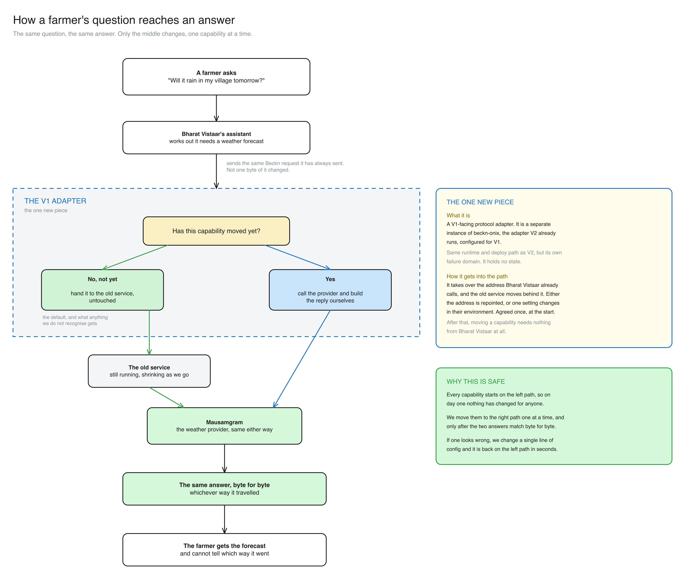
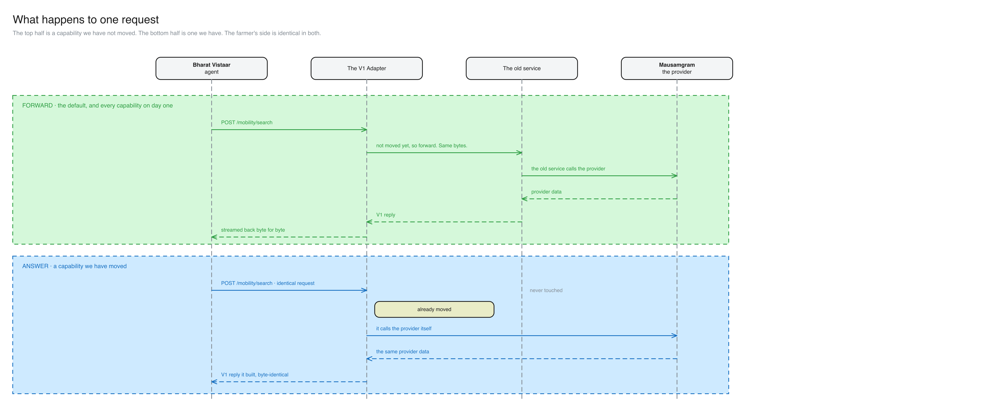

# Bharat Vistaar on OpenAgriNet V2

## Introduction

Today Bharat Vistaar works on Beckn V1. OpenAgriNet V2 is built on Beckn V2. The two protocols do not understand each other, and Bharat Vistaar is not going to change.

So we move Bharat Vistaar onto V2 **without changing how Bharat Vistaar works**. No code change, no protocol change, no change to any request it sends. One address handover is agreed once, at the start. After that, every capability moves with nothing asked of Bharat Vistaar at all.

We move one capability at a time, and every move is reversible in seconds.



---

## The design

### What we add

One component: the **V1 Adapter**.

It is the same software OpenAgriNet V2 already runs as its own adapter, deployed a second time with a different configuration. It speaks V1 to Bharat Vistaar and talks directly to the data providers behind it. No new technology, no new operational surface.

It takes over the address Bharat Vistaar already calls. The old service keeps running, but behind the V1 Adapter rather than in front of it.

Two properties matter:

- **It is separate from V2.** It can be restarted, rolled back or deleted without touching V2, and a V2 release cannot reach Bharat Vistaar.
- **It remembers nothing.** Every decision comes from the request in front of it and its own configuration. Nothing is carried between calls.

### The APIs it has to answer

Bharat Vistaar's agents read one address from their environment and append the action to it. Across the Orchestrator and Voice, they only ever append three:

| | |
|---|---|
| `POST /search` | find something: a forecast, a mandi price, an advisory |
| `POST /init` | start an application or a grievance |
| `POST /status` | check one |

The old service also exposes `/select`, `/confirm`, `/rating` and a handful of non-Beckn routes, but nothing in the Orchestrator, Voice, App or UI calls them. If we take over the whole address, the V1 Adapter passes anything that is not one of the three above straight to the old service, unexamined. So we do not have to be right about the full surface to be safe about it.

### How it knows which capability a request is for

Fifteen capabilities, three endpoints. They do not line up one to one, and that is the part worth being clear about: **the capability is not in the URL.** Almost everything arrives as `POST /search`, and which capability it is comes from one field in the body.

| Value in the request | Capability |
|---|---|
| `knowledge-advisory` | knowledge advisory |
| `Weather-Forecast` | weather, IMD |
| `Weather-Forecast-Mausamgram` | weather, Mausamgram |
| `schemes-agri` | PM-Kisan |
| `icar-schemes` | ICAR schemes |
| `pmfby`, or anything starting with it | PMFBY |
| `price-discovery`, with item code `mandi` | mandi prices |
| **anything else** | knowledge advisory, as a catch-all |

**We are not guessing at this table.** The old service makes exactly this decision, in one place, as a single chain of comparisons. We transcribe it as written, including the awkward parts: the first three match the name with exact capitalisation, the rest match a lowercased code or name, and mandi is the one capability identified by a second field rather than the category.

So "is there a capability to V1 API mapping?" There is, it is short, and it already exists in the old service. Porting it is transcription, not design. The full inventory, with the endpoints and the exact matching rules, is in [current state](current-state.md).

**And if Bharat Vistaar sends something we have never seen, nothing breaks.** It has no row, so it is forwarded, and it reaches the old service's own catch-all exactly as it does today. The worst case is that we fail to recognise something we could have answered ourselves, which costs us nothing and the farmer nothing.

### Two modes per capability

Every capability is in one of two modes, and the mode says what the V1 Adapter does with the request.

| Mode | What the V1 Adapter does | Who answers the farmer |
|---|---|---|
| **forward** | Passes the request to the old service untouched, and returns its reply untouched. | the old service |
| **answer** | Answers it itself: calls the data provider and builds the reply in V1 format. | OpenAgriNet |

**forward is the default, and it is also what anything unrecognised gets.** A capability we have never heard of, or a request we cannot make sense of, goes to the old service. The V1 Adapter never refuses a request, because V1 has no way to express a refusal that the assistant knows how to handle.

On day one every capability is on **forward**, so nothing has changed for anyone.

### Where the modes are defined

In the V1 Adapter's own configuration file, as one row per capability. Nowhere else.

```yaml
capabilities:
  - name: weather-forecast
    mode: answer           # or: forward
    mapping: weather-forecast-v1
  - name: mandi-price
    mode: forward
```

That file is the only place a capability's mode is recorded, and changing a row is a configuration reload rather than a deploy. Nothing else in the system knows which mode a capability is in: not Bharat Vistaar, not the old service, not V2.

A capability with no row is **forwarded**. So the table only ever lists what we have looked at, and leaving something out is always the safe answer.

### Who converts what

**In forward mode, nothing is converted.** The request arrives in V1 and leaves in V1. The old service's reply is already V1 and goes back exactly as it came. There is no transformer in this path at all.

**In answer mode the V1 Adapter does all the converting**, using two mappings per capability. Both are configuration rather than code, and both are written by us:

| Mapping | Direction | What it does |
|---|---|---|
| **request mapping** | V1 request → provider call | pulls out the few values the provider actually needs |
| **response mapping** | provider response → V1 reply | builds the V1 reply from the provider's own fields |

Worked through, for weather:

**1. Bharat Vistaar sends its usual V1 search.**

```json
{"message": {"intent": {
  "category":    {"descriptor": {"name": "Weather-Forecast-Mausamgram"}},
  "fulfillment": {"stops": [{"location": {"lat": 18.4, "lon": 74.4}}]}}}}
```

**2. The request mapping takes the coordinates and calls the forecast provider's own API.**

```
GET https://<forecast-provider>/get-daily?lat=18.4&lon=74.4
```

**3. The provider replies in its own format, which is not Beckn at all.**

```json
{"fcstday1": {"date": "2026-11-05", "rain": 5, "tmin": 18, "tmax": 31},
 "fcstday2": {"date": "2026-11-06", "rain": 0, "tmin": 19, "tmax": 32}}
```

**4. The response mapping turns that into the V1 reply the assistant expects.**

```json
{"context": {"action": "on_search"},
 "message": {"catalog": {"providers": [{"items": [{"tags": [
   {"descriptor": {"code": "Today"},
    "list": [{"descriptor": {"code": "Rainfall"}, "value": "5 mm"}]}]}]}]}}}
```

**Notice what is absent from those four steps: Beckn V2.** The request is never turned into a V2 request, so there is no V2 reply to convert back. The V1 Adapter is V2 software and it runs inside OpenAgriNet V2, but the V2 protocol never appears on the wire.

Two reasons it is built this way rather than V1 → V2 → V1:

- **The provider's response already has everything V1 needs.** V2's own mapping of that same provider deliberately drops fields that V1 shows the farmer. Going through V2 would quietly lose them, and every capability would then need someone to approve a change to what farmers see.
- **It makes byte-for-byte testing possible.** The V1 Adapter reads exactly the data the old service reads, so the reply it builds can be identical to the old one. That is a test we run, not a judgement someone makes.

### Getting it into the path

Bharat Vistaar's agents read the address they call from their own environment, at call time. So we get into the path by changing what that address resolves to, not by changing anything Bharat Vistaar holds.

| | Change | Who makes it | Bharat Vistaar's config |
|---|---|---|---|
| **A** | The DNS record, or one routing rule in front of it | whoever owns that address | untouched |
| **B** | One setting in their environment | their deploy, plus a restart | one line |

**This is not ours to pick alone.** The old service runs on a VM deployed by Tekdi's own pipeline, not in our cluster. Option A is a request to their operators, and it has to be settled before anything is deployed.

It is a one-time cost. After it, moving a capability or moving it back is a change on our side alone, and that is what makes a one-at-a-time migration possible.

### Where it runs

In our own cluster, alongside V2.

It is a second Deployment of the adapter image V2 already runs, with its own Service and its own ingress rule, pointed at its own configuration file in the same bucket V2's adapter reads from. The old service stays where it is, on Tekdi's VM, and the V1 Adapter calls it from our side.

So there is nothing new to build, package or learn how to operate. The build, the deployment, the logs and the dashboards are the ones the team already uses for V2.

### The open question on reply shape

The assistant insists on one envelope around replies, and the weather handler appears to return a different one. Both cannot be true on a working path. Either something in front of the old service is adding the envelope, in which case the V1 Adapter sits behind that, or this path is already broken in production.

Either answer is a configuration value rather than a redesign, but they put the V1 Adapter in different places. **One call against the live address settles it, and it blocks deployment.**

---

## How a request is handled

A farmer asks "will it rain in my village tomorrow?". Bharat Vistaar's assistant works out that it needs a weather forecast and sends the request it has always sent, unchanged, to the address it has always used. That address is now the V1 Adapter.

It asks one question: **has this capability moved yet?**

**No.** The request goes straight through to the old service, and its reply comes straight back. Not one byte is touched in either direction.

**Yes.** The V1 Adapter calls the weather provider itself and builds the V1 reply from what the provider returns.

Either way the provider is the same, the reply is the same, and the farmer cannot tell which path it took.



Even when the V1 Adapter answers a request itself, the original V1 request is what gets logged. That keeps the audit trail and the captured-traffic corpus intact for exactly the capabilities we have moved, which are the ones we most need to be able to debug.

---

## Moving a capability

### Switching one on

| # | Step | Done when |
|---|---|---|
| 1 | Check V2 already covers this capability. If it does not, stop. Building it for V1 only would create a second copy of that integration, to be thrown away later. | the V2 capability is named |
| 2 | Count the traffic. How many calls a day, from which client. | we know it is worth going first |
| 3 | Capture real traffic: real requests, their real replies, and the provider data behind them. | a corpus exists |
| 4 | Write the mapping. Request in, provider call out, reply back in V1 format. | it builds |
| 5 | Test it against the captured traffic. The replies must match byte for byte. | every captured case passes |
| 6 | Deploy it with the capability still on **forward**. The mapping is live but unused. | deployed, nothing changed for anyone |
| 7 | Switch it to **answer** in staging and replay the whole corpus, through both clients. | the farmer sees identical text |
| 8 | Switch it in production and watch. | latency and fallbacks are flat |

Steps 1 to 6 change nothing for anyone. Only step 8 is visible, and it is a configuration reload.

### Worked example: weather

The first candidate, pending the traffic count. Every later capability gets the same table on its own page.

| # | Step | For weather |
|---|---|---|
| 1 | V2 coverage | Exists. **Open:** the V1 Adapter needs the forecast provider's credentials, which today live only in the old service. If it may not hold them, weather cannot go first and mandi does. |
| 2 | Traffic | The App's weather searches. Voice asks a different forecast provider that V2 does not cover yet, so Voice stays on forward. |
| 3 | Capture | Real searches, their replies, and the raw forecast payloads behind them. |
| 4 | Mapping | Coordinates in, one daily-forecast call out, one group of values per day back. |
| 5 | Test | Three transcription traps to cover: a gap in the day sequence must not renumber the days after it; a reading of zero must stay zero and not become "no data"; a missing reading keeps its unit. |
| 6 | Deploy | Mapping live, capability still on forward. |
| 7 | Staging | Replay the corpus. Also confirm the V1 Adapter recognises exactly the requests the old service treated as this capability, and no others. |
| 8 | Production | Switch it to answer. Watch latency and fallbacks. |

Two things to settle before step 4: whether the V1 Adapter may hold the provider credentials, and whether to keep the old service's retry budget of roughly ninety seconds or fail faster.

Field-level detail is on the [weather page](capabilities/weather-mausamgram.md).

### Switching one off

One row back to **forward**, and the capability is answered by the old service again. Configuration reload, no deploy, seconds.

The mapping stays deployed and unused, ready to switch back on once the problem is understood. No other capability is touched, and Bharat Vistaar is not involved at any point. Deleting the row has the same effect, because a capability with no row is forwarded.

### Which can move, and which cannot

Six of the fifteen capabilities are covered by V2 today. The other nine stay on forward until V2 covers them, which keeps that work off the critical path by construction rather than by promise.

**Three of the six cannot move on their own.** PM-Kisan grievance, PM-Kisan application status and PMFBY grievance remember something between calls: a one-time password verified on one request unlocks a later one. The V1 Adapter remembers nothing, so moving half of such a flow would silently drop that check and serve someone's data to a caller who never verified. They move when the whole flow moves, or not at all.

That leaves three that can move now: weather, mandi prices by code, and knowledge advisory. Knowledge advisory is weaker than it looks, because most of its traffic does not come through this path at all.

### When Bharat Vistaar moves to V2

Answering a capability ourselves changes who builds the answer, not what Bharat Vistaar speaks. The last step belongs to them.

V2 is a different address and a different route, so a V2 request never reaches the V1 Adapter. When their client starts sending V2 for a capability, we delete that row and its mapping, and the V1 Adapter carries one capability fewer. When the last row goes, it is deleted.

The old service shrinks the same way, answering less each time a capability moves, until it has no traffic left. **The V1 Adapter is built to disappear, not to become permanent middleware.**

---

## Operating it

### When something fails

If the V1 Adapter cannot work out which capability a request is for, it forwards it. Nothing has been sent yet, so this is always safe.

If it was answering a capability and the attempt fails, it calls the old service and returns that instead. The farmer gets an answer either way.

**There are two exceptions.** On `/init` and `/status` there is no fallback: a silent retry there could send a second one-time password or file a duplicate grievance, so the V1 Adapter returns an error instead.

**Falling back has to raise an alert, not just a dashboard line.** A capability can be completely broken and still look healthy, because the old service is quietly answering every request behind it.

### Turning it off

Four levels, smallest blast radius first. None of them involve Bharat Vistaar.

1. **One row back to forward.** That capability returns to the old service, nothing else moves. Configuration reload.
2. **Forward everything.** Every capability returns at once, behaviour identical to today. Configuration reload.
3. **Roll back the deployment** to the previous build.
4. **Point the address back at the old service.** The V1 Adapter is out of the path entirely.

Level 4 works even if the V1 Adapter will not start. That is what running it separately from V2 buys, and the reason it is worth one extra component. Rehearse it once in staging before go-live.

---

## Status

Design agreed. The adapter is not built, but the weather use case now runs end to end on one machine, against a stubbed provider, so there is a recorded set of V1 replies for the adapter to be written against. See [local stack](local-stack/README.md).

**Blocking:** agree the address handover with whoever operates the old service, and make one call against the live address to settle the reply shape.

**Next:** count real traffic per capability, to pick the first one to move.

See also [current state](current-state.md) for what exists today, and [capabilities](capabilities/README.md) for one page per capability.
